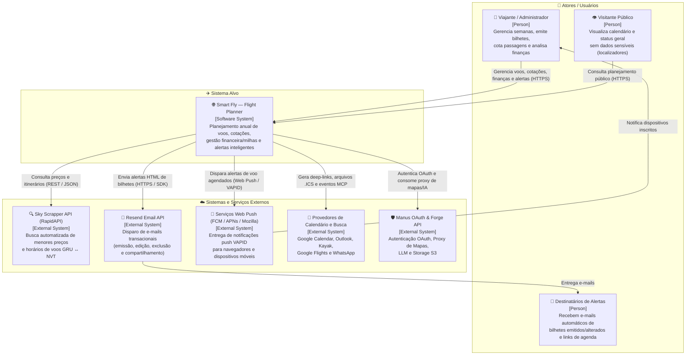
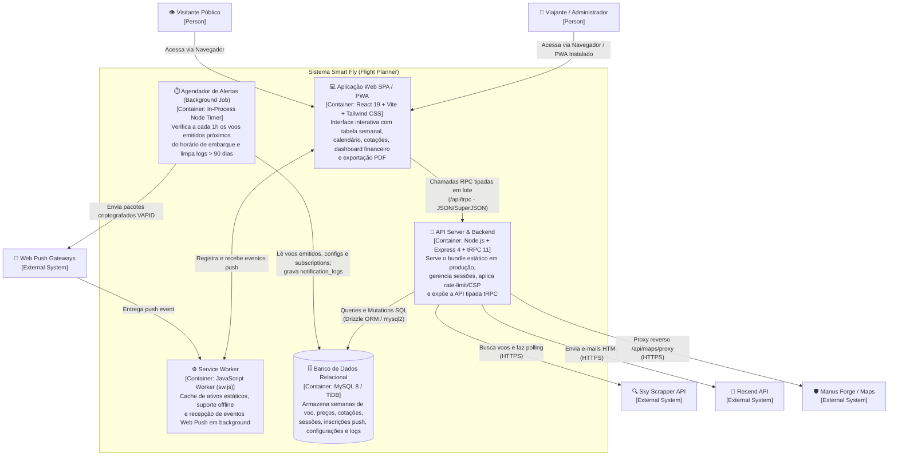
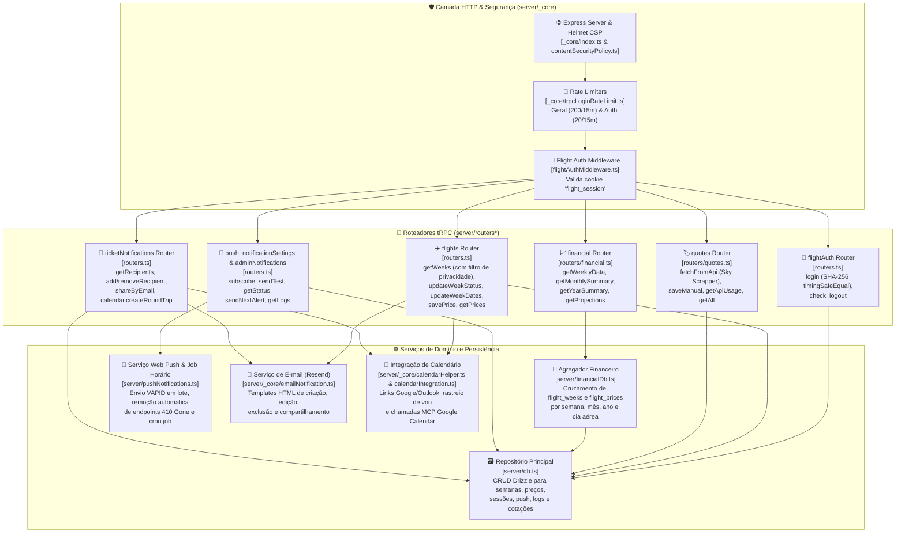
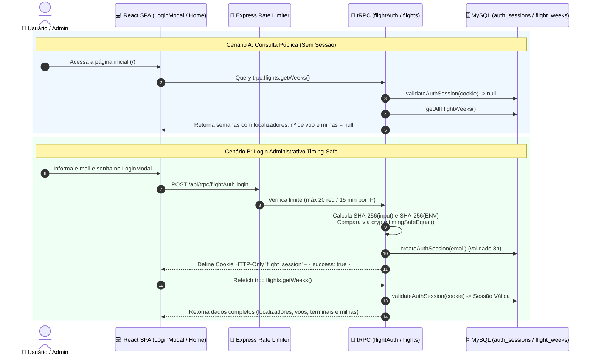
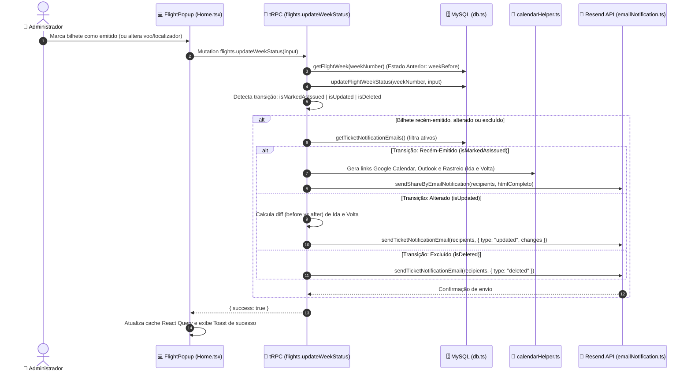
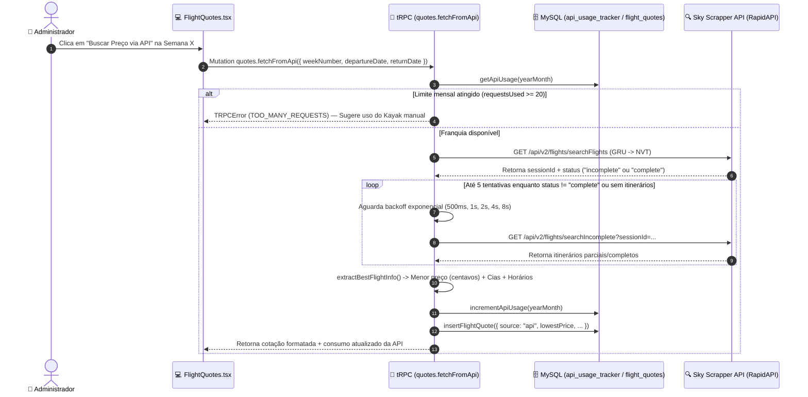
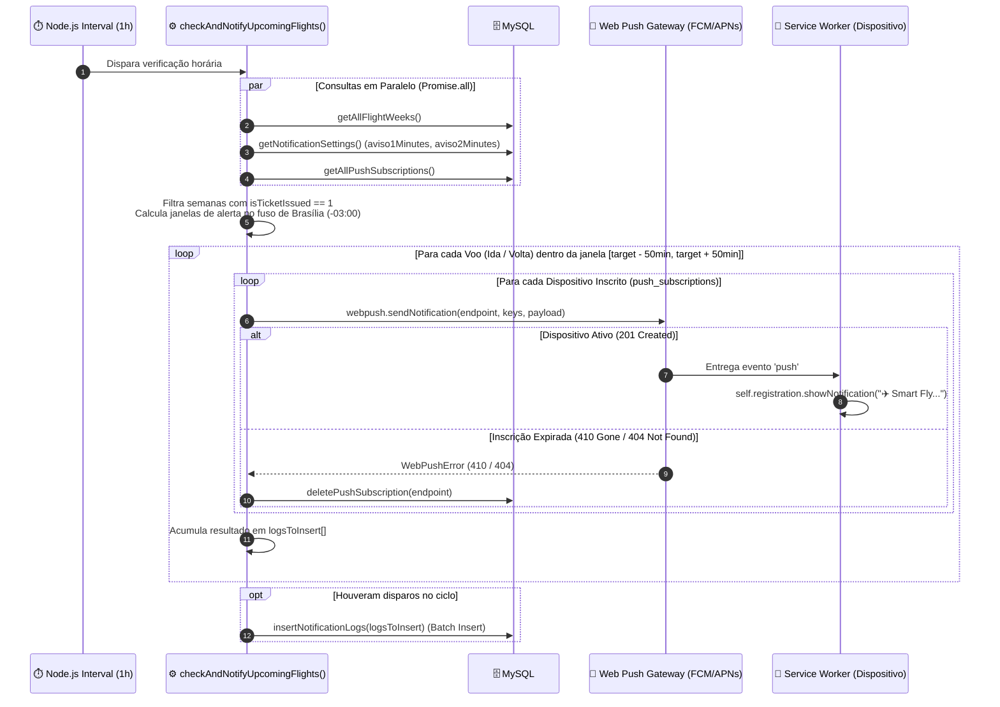

# Documentação Arquitetural C4 Model — Smart Fly (Flight Planner)

Esta documentação descreve a arquitetura completa do sistema **Smart Fly — Planejador de Passagens Aéreas** utilizando a abordagem **C4 Model** (Contexto, Contêineres, Componentes e Código/Dados), acompanhada de diagramas em **Mermaid** e referências diretas ao código-fonte.

---

## 1. Visão Geral do Sistema

O **Smart Fly** é uma aplicação web progressiva (PWA) full-stack voltada para o planejamento anual, cotação, controle de emissão de bilhetes (em R$ e milhas Smiles/LATAM Pass), gestão financeira com projeções sazonais e envio automatizado de alertas (Web Push e E-mail) para viagens aéreas semanais (especialmente na rota fixa **GRU ↔ NVT**).

### Stack Tecnológica Principal

| Camada | Tecnologias | Arquivos Principais |
| :--- | :--- | :--- |
| **Frontend (SPA / PWA)** | React 19, Vite 8, TypeScript, Tailwind CSS 4, Wouter, TanStack Query, tRPC Client, Recharts, Radix UI / shadcn | `client/src/App.tsx`, `client/src/pages/Home.tsx`, `client/public/sw.js` |
| **Backend (API & Jobs)** | Node.js, Express 4, tRPC 11, Zod, Helmet (CSP), Express Rate Limit, Web-Push (VAPID), Resend SDK | `server/_core/index.ts`, `server/routers.ts`, `server/pushNotifications.ts` |
| **Banco de Dados** | MySQL 8 / TiDB, Drizzle ORM, Drizzle Kit (25+ migrations) | `drizzle/schema.ts`, `server/db.ts`, `server/financialDb.ts` |

---

## 2. Nível 1 — Diagrama de Contexto do Sistema (System Context)

O **Nível 1 (Contexto)** mostra como o **Smart Fly** se insere no ambiente, quem são seus usuários e com quais sistemas externos ele se comunica.

### Detalhamento das Integrações Externas
- **Sky Scrapper API (RapidAPI)** (`server/routers/quotes.ts`): Realiza buscas assíncronas de passagens aéreas para a rota fixa `GRU ↔ NVT`, respeitando o limite gratuito mensal monitorado no banco (`api_usage_tracker`).
- **Resend API** (`server/_core/emailNotification.ts`): Envia notificações automáticas sempre que um bilhete é marcado como emitido, alterado ou removido, além de compartilhamento sob demanda.
- **Web Push Protocol (VAPID)** (`server/pushNotifications.ts`): Envia alertas de proximidade de voo (`Aviso 1` e `Aviso 2`) diretamente aos dispositivos registrados.
- **Integrações de Calendário e Deep-Links** (`client/src/lib/calendarHelper.ts`, `server/_core/calendarIntegration.ts`): Criação de eventos no Google Calendar, Outlook, exportação `.ics`, links de rastreio do voo e cotação manual via Kayak.

---

## 3. Nível 2 — Diagrama de Contêineres (Container Diagram)

O **Nível 2 (Contêineres)** detalha as unidades de execução e armazenamento que compõem o sistema **Smart Fly**.

### Responsabilidades de Cada Contêiner

1. **Aplicação Web SPA / PWA (`client/`)**:
   - Construída com **React 19** e empacotada pelo **Vite 8**.
   - Utiliza **Code Splitting (`React.lazy`)** em `client/src/App.tsx` para carregar sob demanda as páginas secundárias (`CalendarView`, `AdminNotifications`, `FlightQuotes`, `Changelog`, `FinancialDashboard`).
   - Comunicação 100% tipada de ponta a ponta com o backend via `@trpc/react-query` e serialização `superjson`.
2. **Service Worker (`client/public/sw.js`)**:
   - Estratégia *Network-First* para navegação e módulos JS/CSS, e *Cache-First* para ativos estáticos (`smartfly-v4`).
   - Escuta eventos `push` e `notificationclick` para exibir alertas nativos do sistema operacional e abrir a aplicação no voo correspondente.
3. **API Server & Backend (`server/_core/index.ts`)**:
   - Servidor **Express 4** protegido com **Helmet** (Content Security Policy customizado em `server/_core/contentSecurityPolicy.ts`) e **Rate Limiting** em duas camadas (`generalLimiter`: 200 req/15min; `authLimiter`: 20 req/15min para `/api/oauth` e `flightAuth.login`).
   - Expõe o adaptador tRPC em `/api/trpc` e um proxy seguro para Google Maps em `/api/maps/proxy`.
4. **Agendador em Background (`server/pushNotifications.ts`)**:
   - Inicializado junto ao servidor via `startFlightNotificationJob()`.
   - Executa `checkAndNotifyUpcomingFlights()` a cada 60 minutos e `cleanupOldLogs()` diariamente às 03:00 UTC.
5. **Banco de Dados Relacional (`drizzle/schema.ts`)**:
   - Instância MySQL 8 / TiDB acessada via pool de conexões `mysql2` e mapeada com **Drizzle ORM**.

---

## 4. Nível 3 — Diagrama de Componentes (Component Diagram)

O **Nível 3 (Componentes)** decompõe tanto a **SPA Frontend** quanto o **Backend API Server** em seus módulos internos e responsabilidades.

### 4.1. Componentes do Frontend (`client/src/`)

```mermaid
flowchart TB
    subgraph AppShell["🧭 Núcleo da Aplicação (client/src)"]
        AppRouter["🧭 App & Router (wouter)\n[App.tsx]\nGerencia rotas e Lazy Loading"]
        Contexts["🌐 Contextos Globais\n[YearContext.tsx / ThemeContext.tsx]\nEstado global de ano ativo e tema claro/escuro"]
        TrpcClient["🔌 Cliente tRPC + React Query\n[lib/trpc.ts & main.tsx]\nCache, invalidação e batching HTTP"]
    end

    subgraph Pages["📄 Páginas da Aplicação (client/src/pages)"]
        HomePage["🏠 Home (Planejador Semanal)\n[Home.tsx]\nTabela das 52 semanas, filtros, preços,\nemissão de bilhetes, milhas e gráficos"]
        CalendarPage["📅 Visão de Calendário\n[CalendarView.tsx]\nCalendário anual, feriados, jogos do Brasil\nna Copa 2026 e detalhes do voo"]
        QuotesPage["💰 Cotações de Passagens\n[FlightQuotes.tsx]\nBusca automática Sky Scrapper API,\nhistórico de preços e atalho Kayak"]
        FinancialPage["📊 Dashboard Financeiro\n[FinancialDashboard.tsx]\nGastos em R$ e milhas por semana/mês/cia\ne projeções 2027 com IPCA e sazonalidade"]
        AdminNotifPage["🔔 Painel Admin de Notificações\n[AdminNotifications.tsx]\nMonitoramento de alertas futuros,\ndispositivos inscritos e logs de envio"]
        ChangelogPage["📝 Novidades (Changelog)\n[Changelog.tsx]\nHistórico de versões e melhorias"]
    end

    subgraph FeatureComponents["🧩 Componentes de Domínio e Hooks"]
        FlightPopup["✈️ FlightPopup & Modais\n[components/flights/FlightPopup.tsx]\nEdição de localizador, voo, terminal e milhas"]
        PdfExport["📄 FlightPdfExport\n[components/FlightPdfExport.tsx]\nExportação de relatórios em PDF (jsPDF)"]
        ShareEmail["📧 ShareByEmailButton\n[components/ShareByEmailButton.tsx]\nCompartilhamento de bilhetes e gestão de e-mails"]
        NotifPopup["⚙️ NotificationSettingsPopup\n[components/NotificationSettingsPopup.tsx]\nConfiguração de Aviso 1 e Aviso 2"]
        WorldCupPanel["🏆 BrazilWorldCupPanel\n[components/BrazilWorldCupPanel.tsx]\nPainel de jogos da Seleção na Copa 2026"]
        LoginModal["🔐 LoginModal\n[components/auth/LoginModal.tsx]\nAutenticação de administrador por e-mail/senha"]
        PushHook["📲 usePushNotifications\n[hooks/usePushNotifications.ts]\nInscrição VAPID no navegador"]
        Helpers["🛠️ Helpers de Domínio\n[lib/flightData.ts, calendarHelper.ts, worldCup2026.ts]\nCálculo de semanas, feriados, links ICS/Google/Outlook"]
    end

    AppRouter --> Contexts
    AppRouter --> HomePage
    AppRouter --> CalendarPage
    AppRouter --> QuotesPage
    AppRouter --> FinancialPage
    AppRouter --> AdminNotifPage
    AppRouter --> ChangelogPage

    HomePage --> FlightPopup
    HomePage --> PdfExport
    HomePage --> ShareEmail
    HomePage --> NotifPopup
    HomePage --> LoginModal
    HomePage --> PushHook
    HomePage --> Helpers

    CalendarPage --> WorldCupPanel
    CalendarPage --> Helpers

    HomePage --> TrpcClient
    CalendarPage --> TrpcClient
    QuotesPage --> TrpcClient
    FinancialPage --> TrpcClient
    AdminNotifPage --> TrpcClient
    ShareEmail --> TrpcClient
    NotifPopup --> TrpcClient
    LoginModal --> TrpcClient
    PushHook --> TrpcClient
```

---

### 4.2. Componentes do Backend (`server/`)

---

## 5. Nível 4 — Código, Modelo de Dados e Fluxos Dinâmicos

O **Nível 4** apresenta o esquema detalhado do banco de dados (Entidade-Relacionamento) e os diagramas de sequência dos fluxos mais críticos implementados no código.

### 5.1. Diagrama Entidade-Relacionamento (Banco de Dados — `drizzle/schema.ts`)

```mermaid
erDiagram
    FLIGHT_WEEKS {
        int id PK
        int year "Default: 2026 (Idx)"
        int weekNumber "Número da semana 1..53 (Idx)"
        varchar departureDate "Data de ida"
        varchar returnDate "Data de volta"
        varchar departureDayOfWeek
        varchar returnDayOfWeek
        varchar holiday "Feriado associado"
        int isDeleted "0 = ativo, 1 = excluído (Idx)"
        int isTicketIssued "0 = pendente, 1 = emitido (Idx)"
        int isSelected "0 ou 1"
        varchar departureAirline "latam | gol | azul"
        varchar returnAirline "latam | gol | azul"
        varchar departureFlightDatetime "YYYY-MM-DDTHH:mm"
        varchar returnFlightDatetime "YYYY-MM-DDTHH:mm"
        varchar departureAirport "Ex: GRU, CGH, VCP"
        varchar returnAirport "Ex: NVT, FLN, JTC"
        varchar departureLocator "Código localizador ida (Sensível)"
        varchar returnLocator "Código localizador volta (Sensível)"
        varchar departureFlightNumber "Número do voo ida (Sensível)"
        varchar returnFlightNumber "Número do voo volta (Sensível)"
        varchar departureTerminal "Terminal embarque ida"
        varchar returnTerminal "Terminal embarque volta"
        varchar ticketType "roundtrip | oneway"
        int smilesPoints "Milhas Smiles gastas"
        int latamPassPoints "Milhas LATAM Pass gastas"
        int departureRescheduled "0 = normal, 1 = remarcado"
        int returnRescheduled "0 = normal, 1 = remarcado"
        timestamp createdAt
        timestamp updatedAt
    }

    FLIGHT_PRICES {
        int id PK
        int year "Default: 2026"
        int weekNumber "FK lógica -> flight_weeks"
        varchar airline "Companhia aérea"
        varchar price "Valor em R$"
        timestamp createdAt
        timestamp updatedAt
    }

    PUBLIC_PRICES {
        int id PK
        int year
        int weekNumber
        varchar airline
        varchar price
        timestamp createdAt
        timestamp updatedAt
    }

    FLIGHT_QUOTES {
        int id PK
        int weekNumber "FK lógica -> flight_weeks (Idx)"
        varchar departureDate "YYYY-MM-DD"
        varchar returnDate "YYYY-MM-DD"
        int lowestPrice "Em centavos (BRL)"
        varchar currency "BRL"
        enum source "api | manual"
        varchar airline
        varchar outboundAirline
        varchar returnAirline
        varchar outboundDeparture "ISO 8601"
        varchar outboundArrival "ISO 8601"
        varchar returnDeparture "ISO 8601"
        varchar returnArrival "ISO 8601"
        int apiRequestsUsed
        text rawResponse "JSON truncado p/ debug"
        timestamp quotedAt "Idx"
    }

    API_USAGE_TRACKER {
        int id PK
        varchar yearMonth UK "Formato YYYY-MM"
        int requestsUsed "Contador mensal"
        int requestsLimit "Default: 20"
        timestamp updatedAt
    }

    AUTH_SESSIONS {
        int id PK
        varchar sessionToken UK "Token aleatório 128 chars"
        varchar email
        timestamp expiresAt "TTL de 8 horas"
        timestamp createdAt
    }

    USERS {
        int id PK
        varchar openId UK "Manus OAuth ID"
        text name
        varchar email
        varchar loginMethod
        enum role "user | admin"
        timestamp lastSignedIn
    }

    OTP_CODES {
        int id PK
        varchar email
        varchar code
        timestamp expiresAt
        int used
    }

    PUSH_SUBSCRIPTIONS {
        int id PK
        text endpoint "URL do servidor Web Push"
        text p256dh "Chave pública ECDH do cliente"
        text auth "Segredo de autenticação"
        varchar userAgent "Dispositivo/Navegador"
        timestamp createdAt
    }

    NOTIFICATION_SETTINGS {
        int id PK
        int aviso1Minutes "Default: 1440 (24h antes)"
        int aviso2Minutes "Default: 0 (Desativado)"
        timestamp updatedAt
    }

    NOTIFICATION_LOGS {
        int id PK
        int weekNumber "FK lógica -> flight_weeks"
        varchar direction "ida | volta"
        varchar avisoLabel "Aviso 1 | Aviso 2 | Teste Manual"
        int avisoMinutes
        varchar airline
        varchar flightNumber
        varchar flightDatetime
        varchar status "success | partial | failed"
        int devicesReached
        int totalDevices
        text errorMessage
        int isTest "0 = automático, 1 = teste"
        timestamp sentAt
    }

    TICKET_NOTIFICATION_EMAILS {
        int id PK
        varchar email UK "Destinatário de alertas"
        varchar name
        int active "1 = ativo, 0 = inativo (Idx)"
        timestamp createdAt
        timestamp updatedAt
    }

    FLIGHT_WEEKS ||--o{ FLIGHT_PRICES : "possui preços (weekNumber + year)"
    FLIGHT_WEEKS ||--o{ FLIGHT_QUOTES : "possui cotações (weekNumber)"
    FLIGHT_WEEKS ||--o{ NOTIFICATION_LOGS : "gera logs de alerta (weekNumber)"
    NOTIFICATION_SETTINGS ||--o{ NOTIFICATION_LOGS : "parametriza disparos"
    PUSH_SUBSCRIPTIONS ||--o{ NOTIFICATION_LOGS : "recebe notificações"
```

---

### 5.2. Fluxo 1: Autenticação Segura e Proteção de Dados Sensíveis

---

### 5.3. Fluxo 2: Emissão/Edição de Bilhete e Disparo Automático de E-mails

---

### 5.4. Fluxo 3: Cotação Automatizada via Sky Scrapper API com Polling Exponencial

---

### 5.5. Fluxo 4: Agendador Horário de Notificações Web Push (VAPID)

---

## 6. Arquitetura de Segurança e Performance

| Aspecto | Implementação no Projeto | Referência no Código |
| :--- | :--- | :--- |
| **Proteção contra Timing Attacks** | Comparação de e-mail e senha utilizando hash fixo `SHA-256` (32 bytes) + `crypto.timingSafeEqual`. | `server/routers.ts` |
| **Sanitização de Dados Públicos** | Visitantes sem sessão válida recebem a lista de semanas com localizadores, números de voo, terminais e milhas zerados (`null`). | `server/routers.ts` |
| **Prevenção de XSS em E-mails** | Todos os campos dinâmicos injetados em templates HTML de e-mail passam pela função `escapeHtml`. | `server/routers.ts`, `server/_core/emailNotification.ts` |
| **Headers HTTP & CSP** | Configuração estrita de `Content-Security-Policy`, `frameguard` e limite de payload JSON em `2mb` via `helmet`. | `server/_core/index.ts`, `server/_core/contentSecurityPolicy.ts` |
| **Rate Limiting em Camadas** | Limite global de 200 req/15min em `/api` e limite estrito de 20 req/15min para login tRPC e OAuth. | `server/_core/index.ts`, `server/_core/trpcLoginRateLimit.ts` |
| **Ocultação de API Key no Frontend** | Proxy reverso `/api/maps/proxy` injeta a credencial `BUILT_IN_FORGE_API_KEY` apenas no servidor. | `server/_core/index.ts` |
| **Otimizações de Banco e CPU (Bolt)** | Índices compostos no MySQL (`idx_flight_weeks_active_issued`), consultas paralelas com `Promise.all`, *batch insert* de logs e loops de passagem única. | `drizzle/schema.ts`, `server/pushNotifications.ts` |
