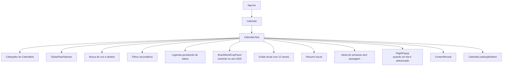
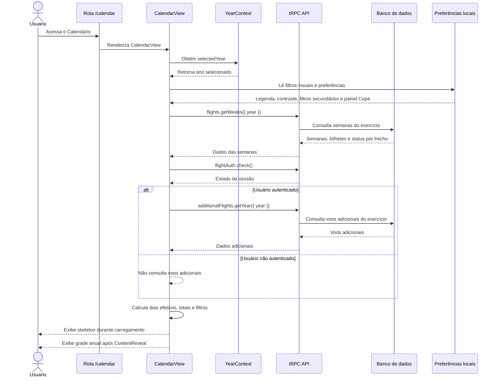
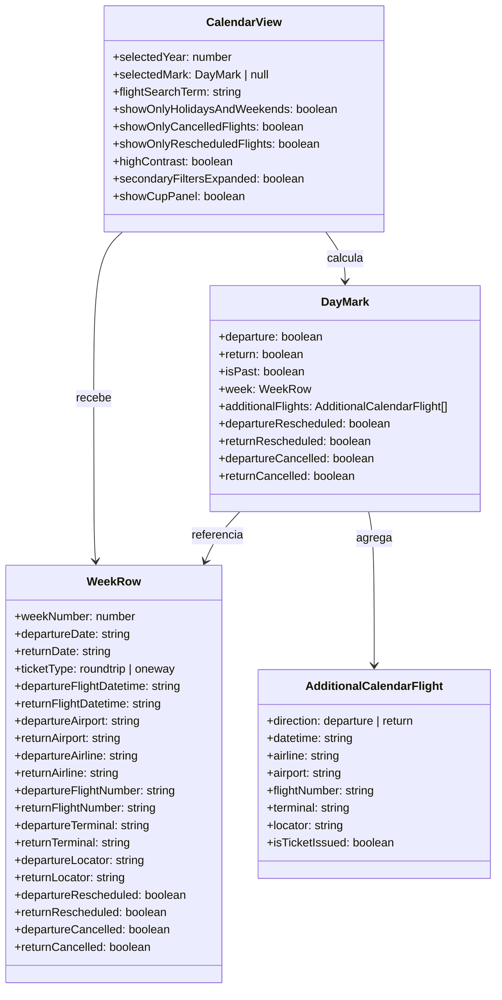
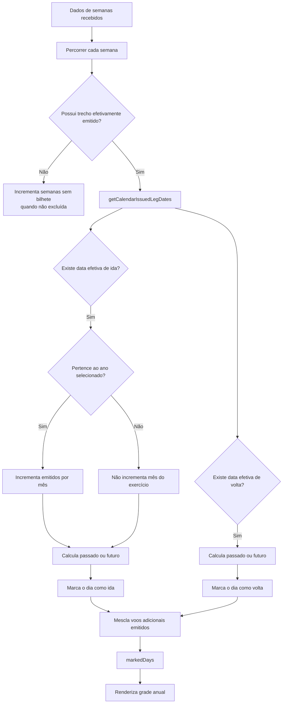
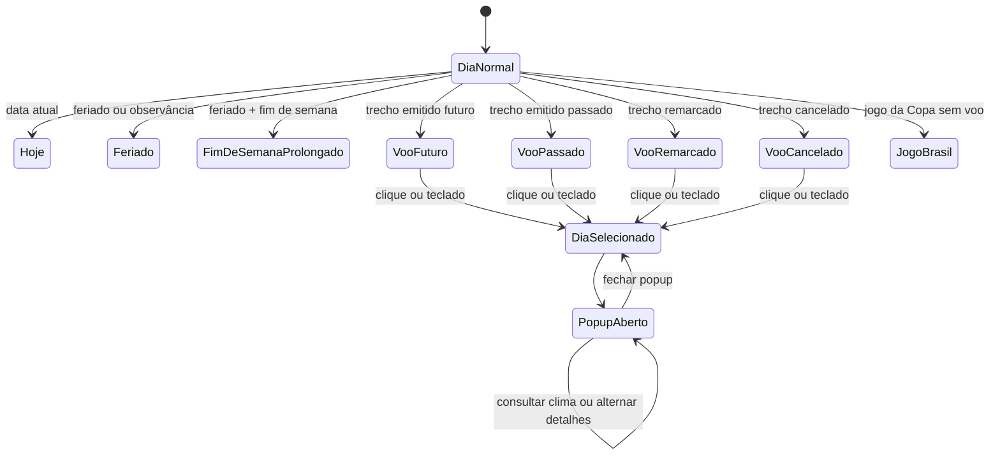
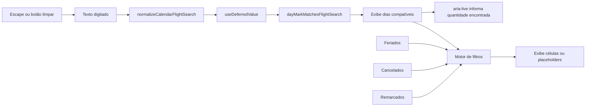
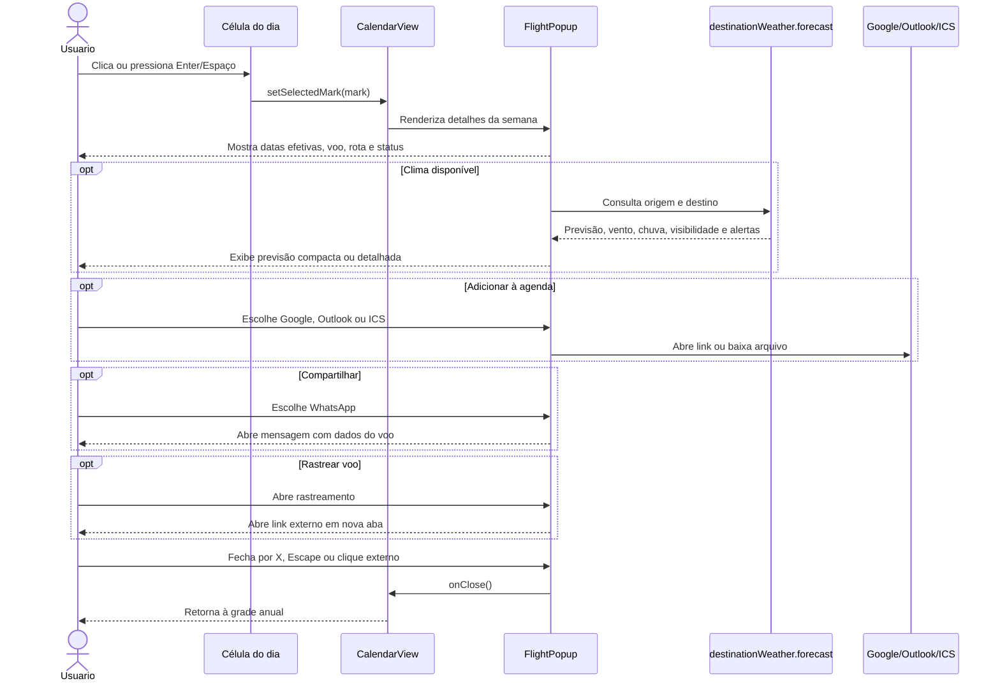
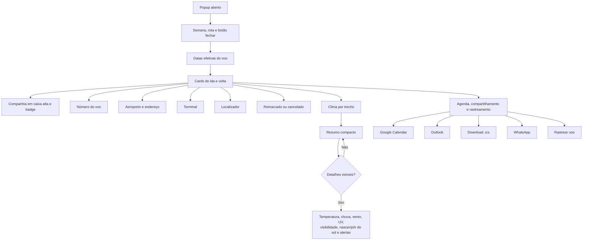
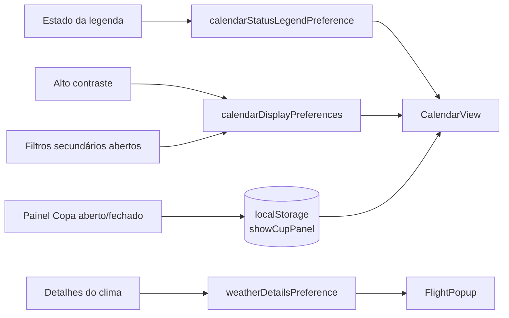
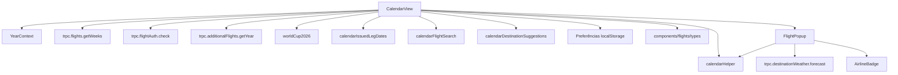

# Tela de Calendário — Documentação Mermaid

> Documentação exclusiva da tela **Calendário** (`/calendar`) do Smart Fly / Viagens.
> Os diagramas abaixo descrevem a composição visual, o fluxo de dados, os filtros, a interação com os dias e o popup de detalhes do voo.

## 1. Escopo da tela

A tela de Calendário apresenta os 12 meses do exercício selecionado, marca os dias com trechos emitidos, permite filtrar e pesquisar voos e abre os detalhes de uma semana ou passagem ao selecionar um dia interativo.

### Entrada principal

- **Rota:** `/calendar`
- **Entrada opcional:** `/calendar?week={n}`, usada para localizar e destacar uma semana específica.
- **Ano:** recebido do `YearContext` por meio do seletor global.
- **Componente principal:** `client/src/pages/CalendarView.tsx`
- **Popup de detalhes:** `client/src/components/flights/FlightPopup.tsx`

## 2. Arquitetura da tela

## 3. Fluxo de carregamento e dados

## 4. Modelo de dados visualizado

## 5. Construção dos dias efetivos

A tela não marca apenas a data planejada da semana. Para cada trecho emitido, utiliza a **data efetiva do bilhete**, considerando remarcações e passagens somente ida.

## 6. Estados visuais do dia

### Convenção visual

| Estado | Representação |
|---|---|
| Voo futuro emitido | Verde |
| Voo passado emitido | Cinza |
| Voo remarcado | Vermelho |
| Voo cancelado | Roxo escuro |
| Hoje sem voo | Azul claro com destaque |
| Feriado ou observância | Indicador de feriado |
| Fim de semana prolongado | Fundo roxo claro |
| Jogo do Brasil sem voo | Cores do resultado ou destaque amarelo |

## 7. Filtros e busca

A busca aceita, conforme o texto acessível da tela:

- número do voo;
- aeroporto;
- destino;
- companhia aérea;
- localizador;
- terminal.

No campo de destino, as sugestões são fornecidas pelo `datalist` alimentado por `getCalendarDestinationSuggestions`.

## 8. Interação com um dia de voo

## 9. Conteúdo do `FlightPopup`

## 10. Preferências persistidas

## 11. Acessibilidade e responsividade

- Células de voo interativas usam `role="button"`, `tabIndex=0` e suporte a **Enter** e **Espaço**.
- Busca, filtros e estados de alto contraste expõem `aria-label`, `aria-describedby`, `aria-controls`, `aria-expanded` e `aria-live`.
- O popup usa `role="dialog"` e `aria-modal="true"`.
- A interface é mobile-first e reorganiza cabeçalho, filtros e grade em telas estreitas.
- O painel de filtros secundários fica recolhido em telas móveis e expandido por controle acessível.
- Animações de hover, transições e rolagem respeitam `prefers-reduced-motion`.
- O skeleton é exibido antes do conteúdo real; `ContentReveal` faz a transição de carregamento.

## 12. Dependências da tela

## 13. Pontos de validação

1. Selecionar outro ano no cabeçalho e confirmar que a grade, os contadores e os bilhetes mudam para o exercício selecionado.
2. Abrir `/calendar?week={n}` e confirmar que a semana correspondente recebe foco/rolagem.
3. Pesquisar por número do voo, destino, localizador e terminal.
4. Ativar os filtros de feriados, cancelados e remarcados em conjunto.
5. Selecionar um voo somente ida e confirmar que não aparece uma volta indevida.
6. Selecionar uma passagem remarcada e confirmar que o Calendário usa a data efetiva emitida.
7. Abrir o popup por clique, Enter e Espaço; fechá-lo por X, Escape e clique externo.
8. Validar agenda Google, Outlook, arquivo ICS, WhatsApp e rastreamento.
9. Testar preferências persistidas após recarregar a tela.
10. Repetir a auditoria em 320 px, 375 px, 390 px e desktop, com redução de movimento ativada.
