# Página Principal — Documentação Mermaid

> Documentação exclusiva da página principal do Smart Fly / Viagens.
> O foco desta documentação é a rota `/`, o dashboard anual de planejamento, seus estados de autenticação, os painéis operacionais e as interações disponíveis.

## 1. Escopo e responsabilidade

A página principal é o dashboard operacional para acompanhar o planejamento anual de viagens aéreas. Ela combina dados de semanas, bilhetes, preços, progresso de emissões, alertas, clima, notificações e preferências de visualização.

- **Rota principal:** `/`
- **Componente:** `client/src/pages/Home.tsx`
- **Modo adicional:** `Home` também pode ser renderizada em `passage-management` para a rota de gestão de passagens.
- **Contexto global:** `YearContext` fornece o exercício selecionado.
- **Autenticação:** `flightAuth.check`, `flightAuth.logout` e `LoginModal`.
- **Tipografia visual do produto:** Roboto, conforme o padrão de conteúdo da aplicação.

## 2. Arquitetura da página

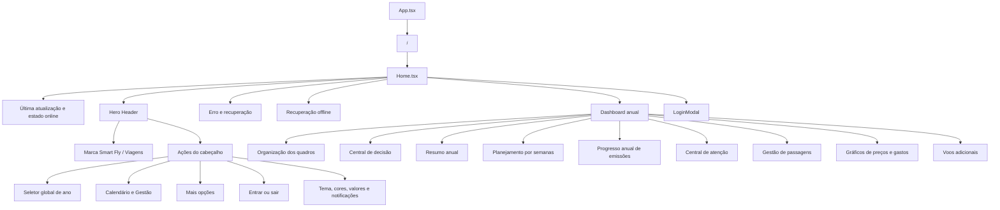

## 3. Fluxo inicial da página

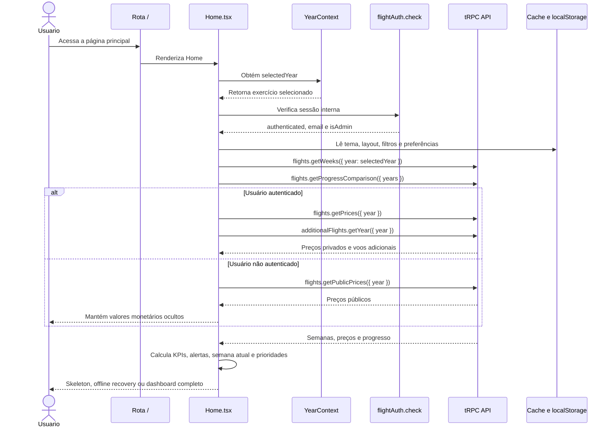

## 4. Dados e consultas principais

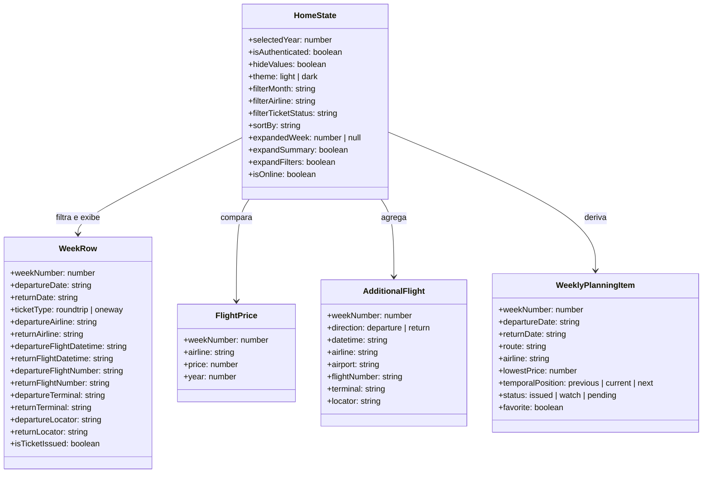

## 5. Estados da página

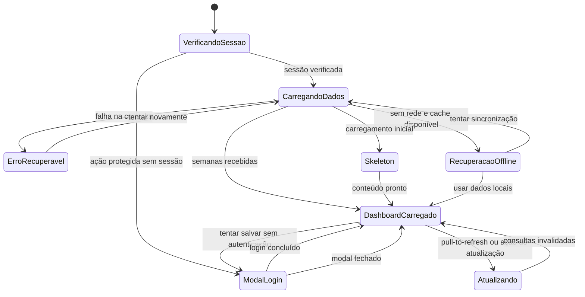

## 6. Cabeçalho e navegação

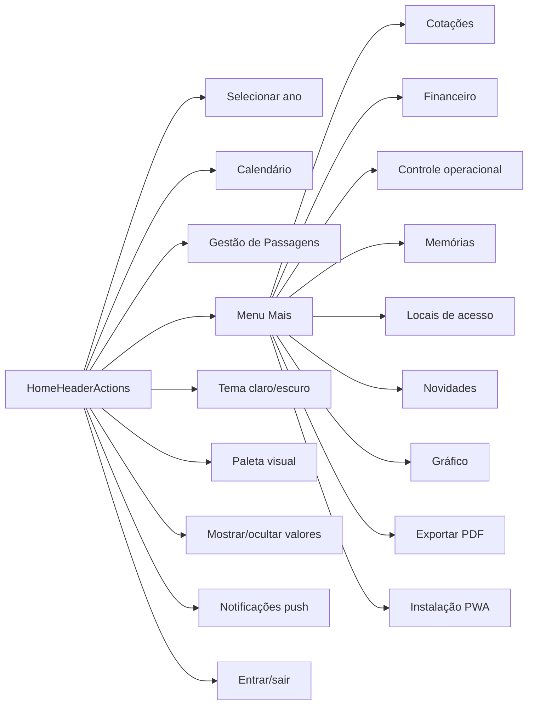

### Regras de navegação

- O seletor de ano altera o contexto compartilhado e atualiza os dados anuais da Home.
- Calendário e Gestão podem alternar sua posição como ação primária em telas móveis.
- Navegações usam transições de visualização quando disponíveis e respeitam `prefers-reduced-motion`.
- Ícones mantêm `aria-label`, tooltips e foco visível mesmo quando o texto é ocultado em telas estreitas.
- O logout invalida a consulta de sessão e exibe confirmação visual.

## 7. Pipeline de transformação dos dados

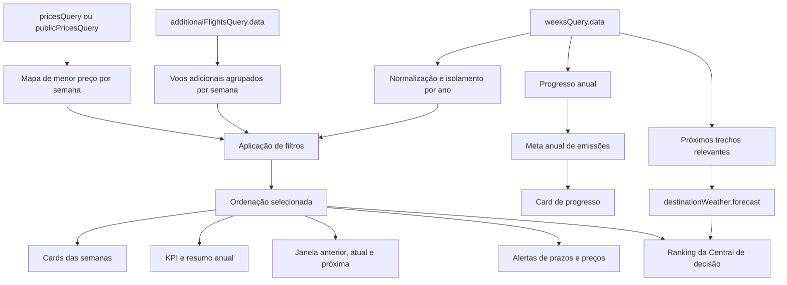

## 8. Central de decisão

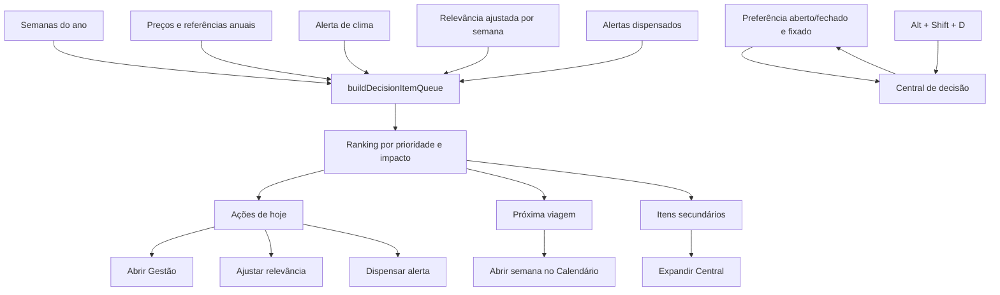

A Central de decisão pode utilizar, entre outros sinais:

- prazo até a viagem;
- passagem ainda não emitida;
- ausência de preço;
- variação de preço;
- referência anual insuficiente;
- previsão de chuva, vento ou baixa visibilidade;
- relevância manual ajustada pelo usuário.

## 9. Resumo anual e metas

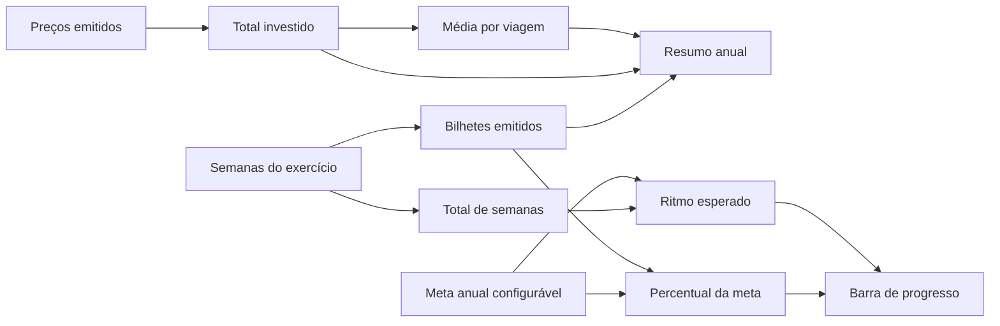

- A meta anual é armazenada por exercício.
- O percentual usa o valor final configurado pelo usuário, sem divisor fixo de 44 semanas.
- O resumo pode ser expandido ou recolhido.
- O estado do resumo é persistido localmente.
- Valores monetários começam ocultos e só podem ser revelados após autenticação.

## 10. Planejamento por semanas

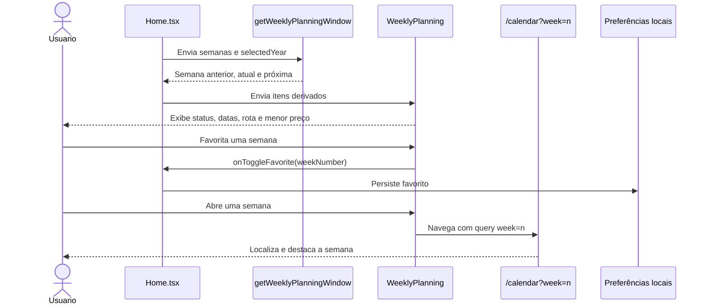

Status dos cards semanais:

- **Emitido:** passagem registrada.
- **Acompanhar preço:** há referência para monitoramento.
- **Pendente:** emissão ou preço ainda requer atenção.

## 11. Filtros e gestão de passagens

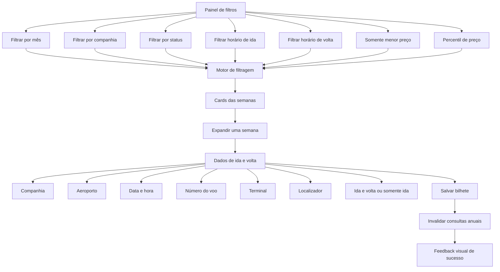

## 12. Ações protegidas por login

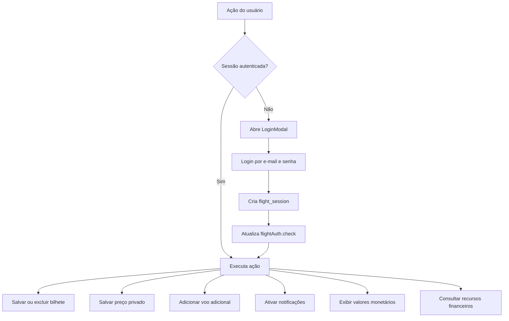

## 13. Atualização manual e modo offline

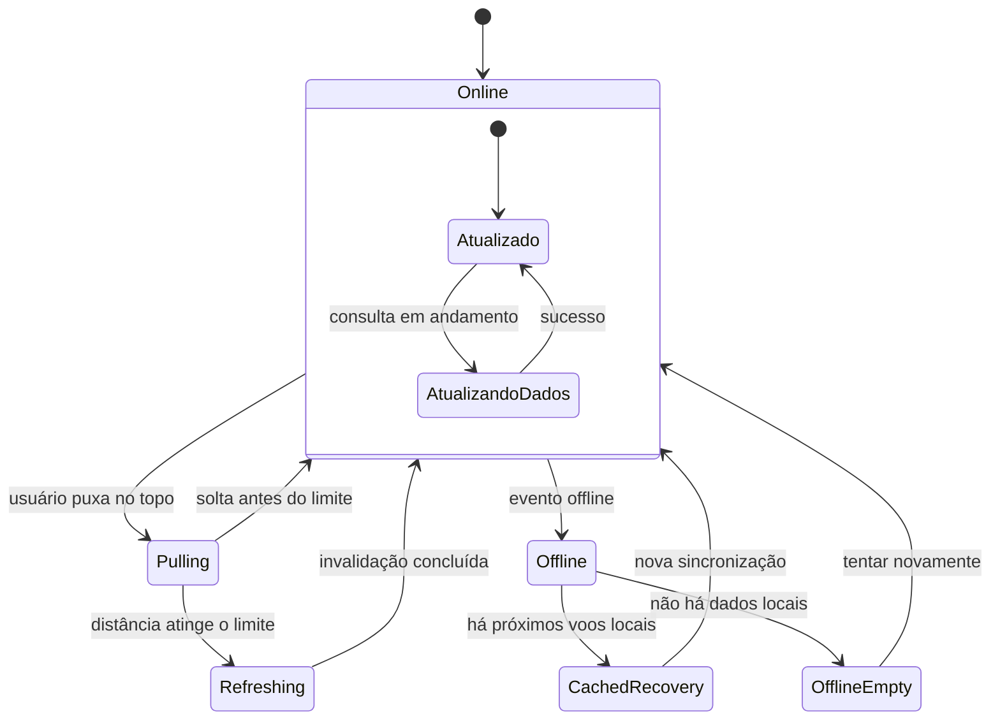

- A Home exibe a última sincronização conhecida.
- Em modo offline, a interface informa a indisponibilidade sem substituir os dados existentes.
- A recuperação usa dados locais essenciais quando disponíveis.
- O pull-to-refresh invalida semanas, progresso, preços e dados relacionados do ano selecionado.

## 14. Preferências persistidas

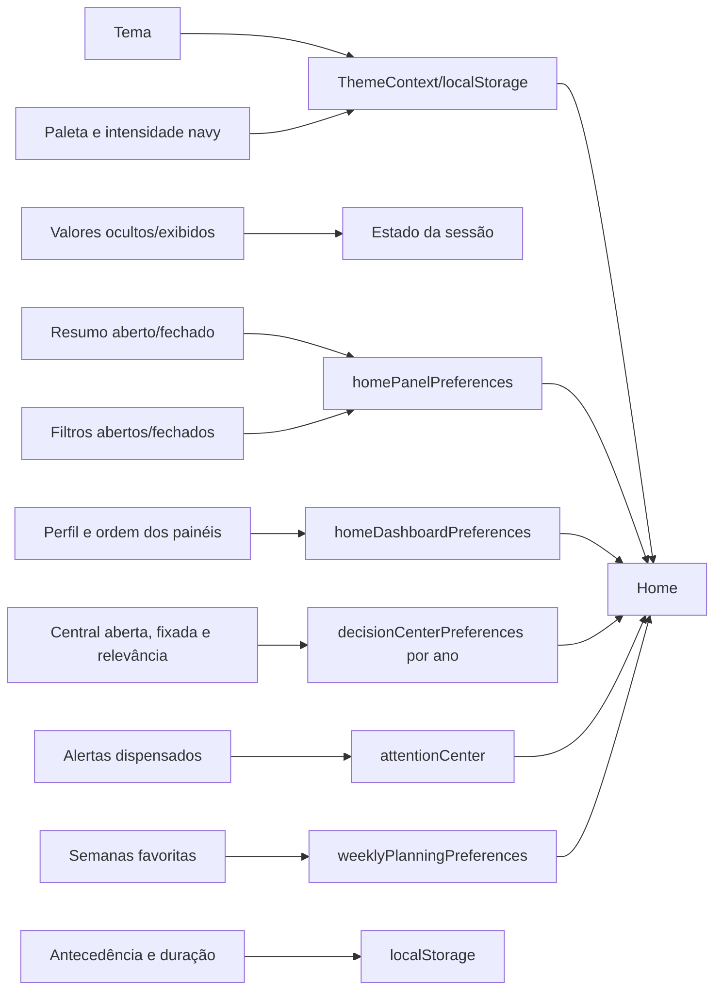

## 15. Acessibilidade e responsividade

- A página é mobile-first e mantém alvos de toque adequados em 320 px, 375 px e 390 px.
- A navegação móvel reduz textos para ícones, preservando `aria-label` e tooltips.
- Cards expansíveis usam `aria-expanded` e `aria-controls`.
- Estados de atualização e offline usam `role="status"` e `aria-live`.
- Ações críticas exibem loading, feedback de sucesso ou mensagem de erro.
- Animações de hover e transições respeitam `prefers-reduced-motion`.
- O layout permite escolher perfil completo, foco, compacto ou personalizado.
- Painéis podem ser fixados, reordenados por arrastar e soltar e restaurados ao padrão.
- Valores financeiros ficam mascarados por padrão para preservar privacidade.

## 16. Pontos de validação

1. Selecionar outro ano e confirmar que semanas, preços, indicadores, alertas e meta mudam para o exercício escolhido.
2. Acessar a Home sem login e confirmar que a página carrega com valores monetários ocultos.
3. Tentar salvar uma passagem sem sessão e confirmar a abertura do `LoginModal`.
4. Entrar, salvar uma passagem e confirmar feedback visual e atualização dos KPIs.
5. Validar a janela de semana anterior, atual e próxima usando a data real de acesso.
6. Aplicar filtros combinados de mês, companhia, status, horário e menor preço.
7. Abrir e fechar Resumo anual, Central de atenção e Central de decisão; recarregar e confirmar persistência.
8. Alterar a meta anual e confirmar o percentual e o ritmo recalculados.
9. Favoritar uma semana e confirmar a persistência após recarregar.
10. Ativar e desativar notificações push com sessão autenticada.
11. Testar pull-to-refresh, modo offline e recuperação local.
12. Repetir a auditoria em desktop e em 320 px, 375 px e 390 px, com redução de movimento ativada.
